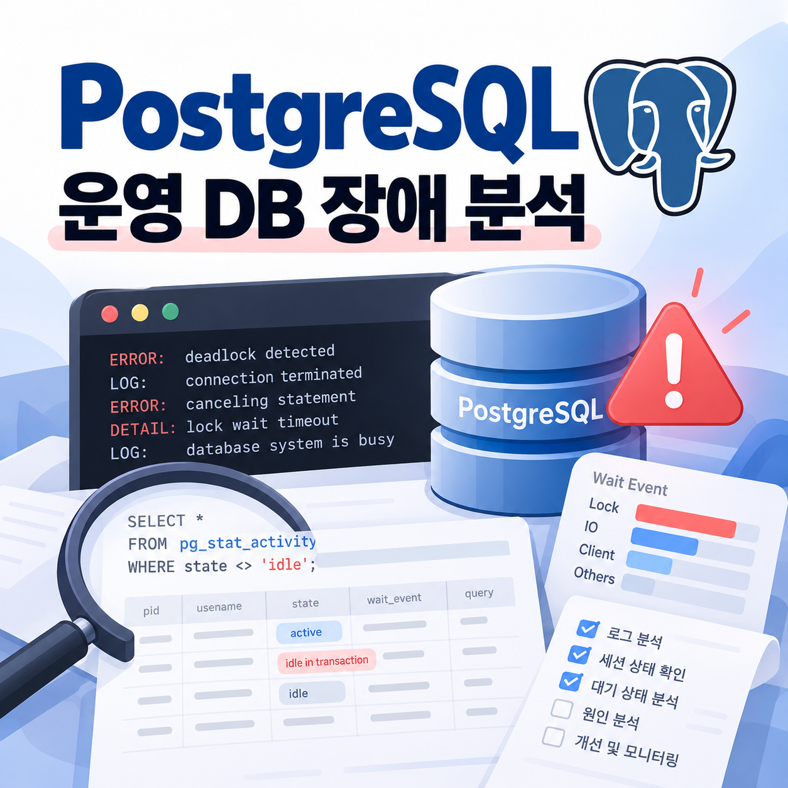
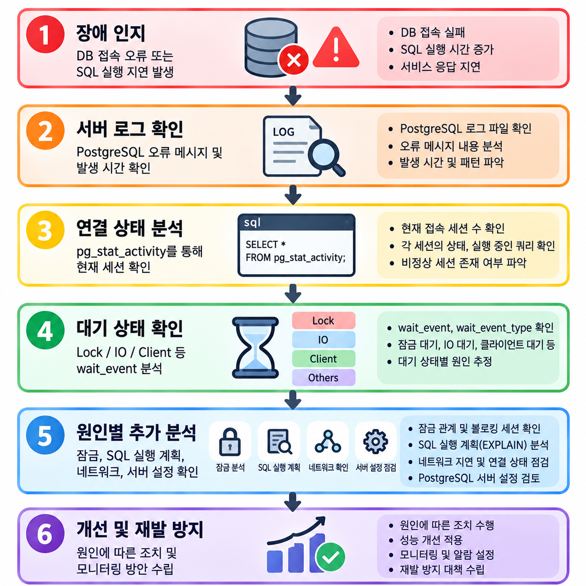
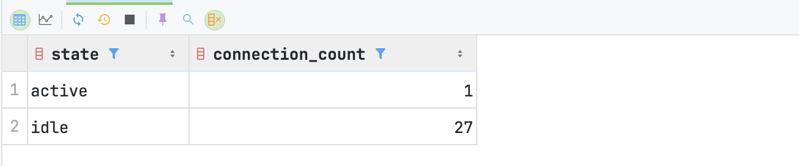
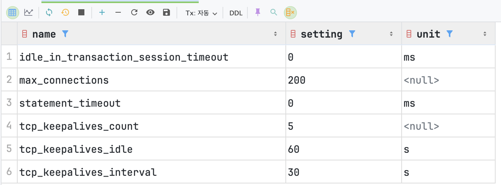

<p>
DB에 문제가 생겼으면, 어떻게 로그를 봐야하고, 어디서부터 문제를 찾아가야할까?
</p>

<p />

> • <b>점검 배경</b>: PostgreSQL 운영 환경에서 클라이언트 연결 단절 및 장시간 SQL 실행 현상 발생<br />• <b>분석 목적</b>: 서버 로그, DB 세션, 대기 이벤트, 시스템 설정을 활용하여 장애 발생 지점과 원인 파악<br />• <b>확인 결과</b>: 클라이언트 연결 단절 로그 확인, PostgreSQL 서버 재시작 정황 미발견, 일부 장시간 실행 SQL에서 임시 파일 읽기 대기(<code>BufFileRead</code>) 확인<br />• <b>핵심 학습</b>: PostgreSQL 장애 발생 시 로그 확인부터 세션 분석, Lock 점검, I/O 병목 분석까지 단계적으로 원인을 좁혀 가는 방법

---

## 1. 실제 장애 사례 분석

### 1-1. 장애 인지 및 현상

PostgreSQL 운영 데이터베이스에서 장시간 실행되는 SQL과 클라이언트 연결 오류가 발생하여 서버 상태를 점검하게 되었습니다.

확인된 주요 증상은 다음과 같습니다.

- <b>클라이언트 연결 오류</b>: JDBC를 사용하는 프로그램에서 데이터베이스 연결 관련 예외 발생
- <b>서버 연결 단절 로그</b>: PostgreSQL 서버 로그에 <code>Connection timed out</code>, <code>connection to client lost</code> 기록
- <b>SQL 실행 지연</b>: 일부 대용량 데이터 집계 SQL이 장시간 실행되는 현상 확인
- <b>서버 상태</b>: 확인한 범위에서 PostgreSQL 프로세스가 중단되거나 재시작된 정황은 발견되지 않음

초기에는 데이터베이스 서버 자체의 장애를 의심할 수 있지만, 연결 오류가 발생했다고 해서 반드시 PostgreSQL 서버에 문제가 있는 것은 아닙니다.

DB 서버, 클라이언트, JDBC 드라이버, 네트워크 장비 등 여러 구간에서 오류가 발생할 수 있기 때문입니다.

따라서 서버 로그와 현재 실행 중인 세션 상태를 함께 확인하여 장애 발생 지점을 좁혀 가는 방식으로 점검하였습니다.

### 1-2. PostgreSQL 서버 로그 확인

서버 로그에서 다음 메시지가 확인되었습니다.

```txt
LOG: could not send data to client: Connection timed out
FATAL: connection to client lost
```

<b>\[로그 해석\]</b>

<code>could not send data to client</code>는 PostgreSQL 서버가 클라이언트로 데이터를 전송하는 과정에서 오류가 발생했음을 의미합니다.

<code>Connection timed out</code>은 해당 네트워크 통신이 제한 시간 내에 정상적으로 완료되지 않았음을 나타냅니다.

<code>connection to client lost</code>는 클라이언트와의 연결이 유지되지 못해 PostgreSQL 백엔드 세션이 종료되었음을 의미합니다.

해당 로그만으로는 클라이언트 PC의 네트워크 문제인지, VPN 또는 방화벽 문제인지, 중간 네트워크 장비의 세션 종료인지 정확히 구분할 수 없습니다.

또한 SQL 실행 시간이 길었다는 사실만으로 연결 단절의 직접적인 원인을 단정할 수도 없습니다.

### 1-3. 클라이언트 측 오류 확인

클라이언트에서는 다음과 같은 JDBC 오류가 기록되었습니다.

```txt
org.postgresql.util.PSQLException:
An I/O error occurred while sending to the backend.
```

이후에는 다음 오류도 반복적으로 발생하였습니다.

```txt
org.postgresql.util.PSQLException:
This connection has been closed.
```

<b>\[로그 해석\]</b>

첫 번째 오류는 JDBC 드라이버가 PostgreSQL 서버와 통신하는 과정에서 I/O 예외가 발생했음을 의미합니다.

두 번째 오류는 이미 종료된 JDBC 연결을 사용하려 했을 때 발생할 수 있습니다.

서버 로그와 클라이언트 로그를 함께 비교하면 네트워크 통신 문제를 의심할 근거를 확보할 수 있습니다.

다만 두 로그가 동일한 연결에서 발생했는지 확인하려면 접속 IP, 포트, 세션 생성 시각, PostgreSQL PID 등을 추가로 대조해야 합니다.

### 1-4. 장애 분석 프로세스



## 2. PostgreSQL 서버 로그 확인 방법

PostgreSQL 장애 분석의 첫 번째 단계는 로그가 어디에 기록되는지 확인하는 것입니다.

### 2-1. 로그 저장 경로 확인

PostgreSQL에서 다음 SQL을 실행합니다.

```txt
SHOW data_directory;
SHOW log_directory;
SHOW log_filename;
SHOW logging_collector;
```

각 설정의 의미는 다음과 같습니다.

| 설정 | 설명 |
| --- | --- |
| <code>data_directory</code> | PostgreSQL 데이터 디렉터리 |
| <code>log_directory</code> | 로그 파일 저장 디렉터리 |
| <code>log_filename</code> | 로그 파일명 생성 규칙 |
| <code>logging_collector</code> | PostgreSQL 로그 수집 프로세스 사용 여부 |

<code>log_directory</code>가 상대 경로라면 일반적으로 PostgreSQL 데이터 디렉터리를 기준으로 해석합니다.

단, 로그가 반드시 해당 경로의 파일에 기록되는 것은 아닙니다. <code>logging_collector</code>가 비활성화된 환경에서는 systemd journal이나 syslog 등 다른 방식으로 관리될 수 있습니다.

### 2-2. Linux 서버에서 로그 확인

로그 파일에 접근할 수 있는 권한이 있다면 다음과 같이 확인할 수 있습니다.

<b>최근 로그 확인</b>

```txt
tail -n 100 /path/to/postgresql.log
```

<b>실시간 로그 확인</b>

```txt
tail -f /path/to/postgresql.log
```

<b>오류 메시지 검색</b>

```txt
grep -Ei "ERROR|FATAL|PANIC" /path/to/postgresql.log
```

<b>연결 단절 관련 로그 검색</b>

```txt
grep -Ei "connection|timeout|could not send" /path/to/postgresql.log
```

<code>/path/to/postgresql.log</code>는 실제 서버 로그 경로로 변경해야 합니다.

로그가 systemd journal에 기록되는 환경이라면 다음 명령어를 사용할 수 있습니다.

```txt
sudo journalctl -u postgresql --since "2026-10-20 08:00:00"
```

서비스 이름은 운영 환경에 따라 <code>postgresql@12-main</code> 등으로 다를 수 있습니다.

### 2-3. PostgreSQL 로그 레벨

| 로그 레벨 | 의미 |
| --- | --- |
| <code>DEBUG</code> | 상세 디버깅 정보 |
| <code>INFO</code> | 정보성 메시지 |
| <code>NOTICE</code> | 사용자에게 전달할 참고 정보 |
| <code>WARNING</code> | 주의가 필요한 상황 |
| <code>ERROR</code> | 현재 SQL 실행에 실패한 오류 |
| <code>FATAL</code> | 현재 세션을 계속 유지할 수 없는 오류 |
| <code>PANIC</code> | PostgreSQL 전체에 영향을 줄 수 있는 심각한 오류 |
| <code>LOG</code> | 서버 운영 및 진단 관련 주요 메시지 |

장애 분석 시에는 <code>ERROR</code>, <code>FATAL</code>, <code>PANIC</code>뿐 아니라 <code>LOG</code>에 기록된 연결 종료, 재시작, 체크포인트 관련 메시지도 확인할 필요가 있습니다.

<p />

<p />

## 3. DB 연결 및 세션 상태 확인

PostgreSQL에서는 <code>pg_stat_activity</code> 시스템 뷰를 통해 현재 접속한 세션과 실행 중인 SQL을 확인할 수 있습니다.

### 3-1. 전체 DB 연결 상태 조회

```txt
SELECT
    pid,
    usename,
    datname,
    client_addr,
    application_name,
    state,
    backend_start,
    query_start,
    now() - query_start AS query_duration,
    wait_event_type,
    wait_event,
    LEFT(query, 1000) AS query
FROM pg_stat_activity
WHERE datname = current_database()
ORDER BY backend_start;
```

<b>\[확인 목적\]</b>

- 어떤 사용자와 클라이언트가 DB에 접속했는지 확인
- 현재 실행 중인 SQL 확인
- 연결이 생성된 시각 확인
- SQL 실행 경과 시간 확인
- 잠금이나 I/O 대기 여부 확인

주요 컬럼의 의미는 다음과 같습니다.

| 컬럼 | 설명 |
| --- | --- |
| <code>pid</code> | PostgreSQL 백엔드 프로세스 ID |
| <code>usename</code> | 접속 계정 |
| <code>client_addr</code> | 클라이언트 IP |
| <code>state</code> | 세션의 현재 상태 |
| <code>backend_start</code> | 세션 연결 시작 시각 |
| <code>query_start</code> | 현재 또는 마지막 SQL 시작 시각 |
| <code>wait_event_type</code> | 대기 이벤트 유형 |
| <code>wait_event</code> | 구체적인 대기 이벤트 |
| <code>query</code> | 현재 또는 마지막 SQL |

### 3-2. 세션 상태별 연결 수 확인

```txt
SELECT
    state,
    COUNT(*) AS connection_count
FROM pg_stat_activity
WHERE datname = current_database()
GROUP BY state
ORDER BY state;
```

| 상태 | 의미 |
| --- | --- |
| <code>active</code> | SQL 실행 중 |
| <code>idle</code> | 연결은 유지하지만 현재 SQL을 실행하지 않는 상태 |
| <code>idle in transaction</code> | 트랜잭션이 열린 상태에서 SQL 실행 없이 대기 |
| <code>idle in transaction (aborted)</code> | 트랜잭션 내 오류 발생 후 롤백되지 않은 상태 |



특히 <code>idle in transaction</code>이 장시간 유지되면 잠금이 해제되지 않거나 VACUUM 작업에 영향을 줄 수 있으므로 확인이 필요합니다.

단, <code>idle</code> 세션이 많다는 이유만으로 장애라고 판단해서는 안 됩니다. 커넥션 풀을 사용하는 애플리케이션에서는 정상적으로 유지되는 유휴 연결이 존재할 수 있습니다.

### 3-3. 장시간 실행 중인 SQL 확인

```txt
SELECT
    pid,
    usename,
    client_addr,
    now() - query_start AS duration,
    wait_event_type,
    wait_event,
    LEFT(query, 2000) AS query
FROM pg_stat_activity
WHERE datname = current_database()
  AND state = 'active'
ORDER BY query_start;
```

이 SQL은 현재 실행 중인 쿼리 중 오래 실행되고 있는 작업을 식별할 때 활용합니다.

다만 SQL 실행 시간이 길다고 해서 반드시 비정상적인 것은 아닙니다. 대용량 집계나 데이터 적재처럼 원래 시간이 오래 걸리는 작업일 수도 있기 때문에 대기 이벤트와 실행 계획을 함께 분석해야 합니다.

<p />

<p />

## 4. 잠금(Lock) 대기 및 차단 세션 확인

SQL이 오래 걸리는 원인 중 하나는 다른 트랜잭션이 보유한 잠금으로 인해 작업이 대기하는 경우입니다.

### 4-1. 잠금 대기 상태 조회

```txt
SELECT
    pid,
    state,
    wait_event_type,
    wait_event,
    pg_blocking_pids(pid) AS blocking_pids,
    LEFT(query, 1000) AS query
FROM pg_stat_activity
WHERE datname = current_database()
  AND state = 'active';
```

<b>\[확인 목적\]</b>

- SQL이 다른 세션의 잠금 때문에 대기 중인지 확인
- 해당 세션을 차단하는 PID 확인
- 잠금 외 다른 대기 이벤트 확인

<code>pg_blocking_pids(pid)</code>는 특정 세션의 잠금 획득을 막고 있는 다른 세션의 PID 배열을 반환합니다.

예를 들어 다음과 같은 결과가 있다면,

```txt
pid    wait_event_type   wait_event   blocking_pids
8470   Lock              relation     {76536}
```

PID 8470이 relation 잠금을 기다리고 있고, PID 76536이 해당 잠금 획득을 막고 있음을 의미합니다.

반면 다음과 같은 결과라면,

```txt
pid    wait_event_type   wait_event   blocking_pids
89600  IO                BufFileRead  {}
```

조회 시점에 다른 세션의 잠금으로 차단된 것은 아니며, 임시 작업 파일을 읽는 I/O 대기가 발생한 것입니다.

<p />

### 4-2. 상세 잠금 정보 확인

```txt
SELECT
    l.pid,
    a.usename,
    l.locktype,
    l.mode,
    l.granted,
    l.relation::regclass AS relation_name,
    a.state,
    LEFT(a.query, 1000) AS query
FROM pg_locks l
LEFT JOIN pg_stat_activity a
    ON l.pid = a.pid
WHERE a.datname = current_database()
ORDER BY l.pid, l.granted;
```

<b>\[확인 목적\]</b>

- 어떤 세션이 잠금을 보유하고 있는지 확인
- 어떤 잠금을 기다리고 있는지 확인
- 잠금 종류와 대상 테이블 확인

<code>granted = true</code>이면 잠금을 획득한 상태이고, <code>granted = false</code>이면 잠금 획득을 기다리는 상태입니다.

### 4-3. Lock과 Deadlock의 차이

- <b>Lock 대기</b>
  <p>
  다른 트랜잭션이 필요한 잠금을 보유하고 있어 SQL이 대기하는 상태입니다. 차단 중인 트랜잭션이 종료되면 작업이 진행될 수 있습니다.
  </p>
- <b>Deadlock</b>
  <p>
  두 개 이상의 트랜잭션이 서로 상대방의 잠금 해제를 기다리는 순환 대기 상태입니다.
  </p>

  <p>
  PostgreSQL은 데드락을 감지하면 관련 트랜잭션 중 하나를 중단하여 순환 대기를 해소합니다.
  </p>

  <p>
  따라서 장시간 잠금 대기가 발생했다고 해서 반드시 데드락인 것은 아닙니다.
  </p>

<p />

## 5. 디스크 I/O 및 SQL 실행 지연 분석

잠금 문제가 확인되지 않았더라도 SQL이 오래 실행될 수 있습니다.

대용량 테이블 조회, 정렬, 해시 집계, 중복 제거 작업 등에서 메모리와 디스크 I/O가 많이 발생할 수 있기 때문입니다.

### 5-1. 실제 확인한 I/O 대기 사례

세션 조회 결과 다음과 같은 상태가 확인되었습니다.

```txt
pid    state    wait_event_type    wait_event    blocking_pids
89600  active   IO                 BufFileRead   {}
```

<b>\[결과 해석\]</b>

- <code>active</code>: SQL이 실행 중인 상태
- <code>IO</code>: I/O 작업을 기다리는 상태
- <code>BufFileRead</code>: PostgreSQL 임시 작업 파일을 읽는 과정에서 대기
- <code>{}</code>: 다른 세션의 잠금 차단은 확인되지 않음

이는 해당 시점에 SQL이 임시 작업 파일을 읽으면서 I/O 대기가 발생했음을 의미합니다.

다만 한 번의 조회만으로 지속적인 디스크 병목이라고 결론 내릴 수는 없습니다.

### 5-2. PostgreSQL 대기 이벤트 종류

| 대기 유형 | 예시 | 의미 |
| --- | --- | --- |
| <code>Lock</code> | <code>relation</code>, <code>transactionid</code> | 다른 세션의 잠금 해제 대기 |
| <code>IO</code> | <code>DataFileRead</code> | 테이블 또는 인덱스 데이터 파일 읽기 대기 |
| <code>IO</code> | <code>BufFileRead</code> | 임시 작업 파일 읽기 대기 |
| <code>IO</code> | <code>BufFileWrite</code> | 임시 작업 파일 쓰기 대기 |
| <code>Client</code> | <code>ClientRead</code> | 클라이언트의 데이터 전송 또는 명령 대기 |
| <code>Client</code> | <code>ClientWrite</code> | 클라이언트로 데이터 전송 중 대기 |
| <code>LWLock</code> | 이벤트별 상이 | PostgreSQL 내부 공유 자원 관련 대기 |

<code>ClientRead</code>가 관찰되었다고 해서 반드시 네트워크 장애가 발생한 것은 아닙니다. 클라이언트가 다음 요청을 보내기를 기다리는 정상적인 상태에서도 나타날 수 있습니다.

### 5-3. 임시 파일 사용량 확인

```txt
SELECT
    datname,
    temp_files,
    pg_size_pretty(temp_bytes) AS temp_size,
    stats_reset
FROM pg_stat_database
WHERE datname = current_database();
```

<b>\[확인 목적\]</b>

- PostgreSQL에서 생성한 임시 파일 수 확인
- 임시 파일에 기록된 누적 데이터 크기 확인
- 대용량 정렬 및 집계로 인한 디스크 사용 가능성 분석

<code>temp_files</code>, <code>temp_bytes</code>는 통계가 초기화된 이후의 누적값입니다.

따라서 특정 SQL 한 건의 임시 파일 사용량을 직접 의미하지는 않습니다.

장애 분석 시에는 일정한 간격으로 값을 확인하여 증가량을 비교하는 것이 유용합니다.

### 5-4. SQL 실행 계획 확인

특정 SQL이 반복적으로 느리다면 실행 계획을 확인할 수 있습니다.

```txt
EXPLAIN
SELECT *
FROM cdm.measurement
WHERE unit_concept_id = 0;
```

<code>EXPLAIN</code>은 PostgreSQL이 해당 SQL을 어떤 방식으로 실행할 예정인지 보여줍니다.

주요 실행 계획 항목은 다음과 같습니다.

| 실행 계획 | 의미 |
| --- | --- |
| <code>Seq Scan</code> | 테이블을 순차적으로 읽는 방식 |
| <code>Index Scan</code> | 인덱스를 활용하여 데이터를 조회하는 방식 |
| <code>Index Only Scan</code> | 조건에 따라 인덱스 중심으로 데이터를 조회하는 방식 |
| <code>Sort</code> | 정렬 작업 |
| <code>HashAggregate</code> | 해시 기반 집계 |
| <code>Nested Loop</code> | 중첩 반복 조인 |
| <code>Hash Join</code> | 해시 기반 조인 |

<code>Seq Scan</code>이 사용된다고 해서 무조건 비효율적인 것은 아닙니다. 테이블 대부분의 데이터를 읽는 경우에는 순차 스캔이 더 유리할 수 있습니다.

참고로 <code>EXPLAIN ANALYZE</code>는 SQL을 실제 실행하므로, 운영 DB에서는 실행 비용과 영향도를 검토한 후 사용해야 합니다.

<p />

## 6. PostgreSQL 서버 설정 점검

SQL 지연이나 연결 오류가 발생하면 PostgreSQL 설정도 함께 확인해야 합니다.

### 6-1. 연결 및 타임아웃 설정

```txt
SELECT
    name,
    setting,
    unit
FROM pg_settings
WHERE name IN (
    'max_connections',
    'statement_timeout',
    'idle_in_transaction_session_timeout',
    'tcp_keepalives_idle',
    'tcp_keepalives_interval',
    'tcp_keepalives_count'
);
```

| 설정 | 의미 |
| --- | --- |
| <code>max_connections</code> | 최대 동시 연결 수 |
| <code>statement_timeout</code> | SQL 실행 시간 제한 |
| <code>idle_in_transaction_session_timeout</code> | 트랜잭션 내 유휴 세션 제한 |
| <code>tcp_keepalives_idle</code> | Keepalive 시작 전 대기 시간 |
| <code>tcp_keepalives_interval</code> | Keepalive 재시도 간격 |
| <code>tcp_keepalives_count</code> | Keepalive 재시도 횟수 |

<code>statement_timeout = 0</code>이면 PostgreSQL 자체의 SQL 실행 시간 제한이 비활성화된 상태입니다.



다만 JDBC 드라이버나 네트워크 장비에서 별도의 타임아웃을 적용할 수 있으므로, 서버 설정만으로 모든 연결 종료 가능성을 배제할 수는 없습니다.

<p />

### 6-2. 메모리 및 병렬 처리 설정

```txt
SELECT
    name,
    setting,
    unit
FROM pg_settings
WHERE name IN (
    'shared_buffers',
    'work_mem',
    'effective_cache_size',
    'max_parallel_workers',
    'max_parallel_workers_per_gather'
);
```

| 설정 | 의미 |
| --- | --- |
| <code>shared_buffers</code> | PostgreSQL 공유 버퍼 크기 |
| <code>work_mem</code> | 정렬, 해시 등 개별 작업에서 사용하는 메모리 한도 |
| <code>effective_cache_size</code> | 실행 계획 수립에 사용하는 캐시 추정값 |
| <code>max_parallel_workers</code> | 전체 병렬 워커 수 |
| <code>max_parallel_workers_per_gather</code> | 병렬 쿼리의 Gather 노드당 워커 수 |

특히 <code>work_mem</code>은 전체 서버에 한 번만 할당되는 메모리가 아닙니다.

하나의 SQL에서도 여러 정렬 및 해시 연산이 발생할 수 있고, 동시 실행 세션이나 병렬 워커에 따라 메모리 사용량이 증가할 수 있습니다.

따라서 SQL이 느리다는 이유만으로 <code>work_mem</code>을 무조건 증가시키는 것은 위험합니다.

<p />

<p />

## 7. 테이블 규모 및 인덱스 점검

대용량 테이블에서 SQL 실행 시간이 길어진다면 데이터 규모와 기존 인덱스 구성도 확인해야 합니다.

### 7-1. 테이블별 추정 데이터 건수

```txt
SELECT
    relname AS table_name,
    n_live_tup AS estimated_rows,
    n_dead_tup AS dead_rows,
    last_analyze,
    last_autoanalyze
FROM pg_stat_user_tables
WHERE schemaname = 'cdm'
ORDER BY n_live_tup DESC
LIMIT 20;
```

<code>n_live_tup</code>은 PostgreSQL 통계 기반 추정값이므로 실제 행 수와 차이가 발생할 수 있습니다.

### 7-2. 테이블별 디스크 사용량

```txt
SELECT
    relname AS table_name,
    pg_size_pretty(pg_total_relation_size(relid))
        AS total_size,
    pg_size_pretty(pg_relation_size(relid))
        AS table_size,
    pg_size_pretty(pg_indexes_size(relid))
        AS index_size
FROM pg_stat_user_tables
WHERE schemaname = 'cdm'
ORDER BY pg_total_relation_size(relid) DESC
LIMIT 20;
```

이 SQL을 통해 테이블 본체, 인덱스 및 기타 부속 저장 공간을 포함한 크기를 확인할 수 있습니다.

### 7-3. 기존 인덱스 확인

```txt
SELECT
    tablename,
    indexname,
    indexdef
FROM pg_indexes
WHERE schemaname = 'cdm'
ORDER BY tablename, indexname;
```

<b>\[확인 목적\]</b>

- 기존 인덱스 구성 확인
- 조회 조건에 적합한 인덱스 존재 여부 확인
- 중복되거나 불필요한 인덱스 검토

인덱스는 조회 성능을 개선할 수 있지만, 모든 SQL에서 효과적인 것은 아닙니다.

또한 인덱스 생성에는 디스크 공간과 CPU, I/O 자원이 필요하므로 운영 환경에서는 실행 계획과 영향도를 먼저 확인해야 합니다.

<p />

## 8. 장애 유형별 점검 방법 요약

| 장애 증상 | 우선 확인할 항목 | 주요 도구 |
| --- | --- | --- |
| DB 연결 실패 | 서버 로그, 접속 정보, 네트워크 | PostgreSQL 로그, <code>pg_stat_activity</code> |
| JDBC 연결 단절 | TCP 연결 상태, JDBC 설정, 서버 로그 | 서버 로그, 클라이언트 로그 |
| SQL 무한 대기 | 잠금 및 차단 세션 | <code>pg_blocking_pids()</code>, <code>pg_locks</code> |
| SQL 실행 지연 | 실행 SQL, 대기 이벤트, 실행 계획 | <code>pg_stat_activity</code>, <code>EXPLAIN</code> |
| 디스크 I/O 대기 | 대기 이벤트, 임시 파일 사용량 | <code>wait_event</code>, <code>pg_stat_database</code> |
| 대용량 테이블 조회 지연 | 테이블 크기, 통계, 인덱스 | <code>pg_stat_user_tables</code>, <code>pg_indexes</code> |
| 연결 수 증가 | 활성 및 유휴 연결 수 | <code>pg_stat_activity</code>, <code>max_connections</code> |

<p />

## 9. 개선 방안 및 운영 환경 대응 가이드

### 9-1. 장애 발생 시 로그부터 확인

- 오류 발생 시간을 기준으로 PostgreSQL 서버 로그와 애플리케이션 로그 비교
- 접속 IP, PID, 세션 시작 시간 등을 활용해 관련 연결 식별
- 서버 재시작 여부와 연결 종료 원인을 구분하여 분석
- 오류 메시지만으로 원인을 단정하지 않고 추가 근거 확보

### 9-2. 장시간 실행 SQL 모니터링

- <code>pg_stat_activity</code>를 활용해 현재 실행 중인 SQL 확인
- 실행 시간과 대기 이벤트를 함께 분석
- <code>Lock</code> 대기와 <code>IO</code> 대기를 구분하여 대응
- 반복적으로 느린 SQL은 실행 계획 및 인덱스 구성 검토

### 9-3. 운영 DB 변경 작업 최소화

- 장애 원인이 확인되기 전 무분별한 세션 종료 지양
- 운영 시간 중 대용량 인덱스 생성 및 테이블 구조 변경 주의
- <code>EXPLAIN ANALYZE</code> 등 실제 SQL을 실행하는 진단 명령은 영향도 검토 후 사용
- 서버 설정 변경은 변경 전후 성능과 안정성을 비교하여 적용

### 9-4. 클라이언트 및 네트워크 환경 점검

- JDBC 드라이버 버전 및 연결 설정 확인
- VPN, 방화벽, NAT 장비의 세션 유지 정책 점검
- 클라이언트 PC의 절전 및 네트워크 재연결 이력 확인
- 장시간 실행되는 작업은 네트워크 상태와 DB 세션 상태를 함께 모니터링

<p />

<p />

## 10. 정리 및 회고

이번 점검을 통해 PostgreSQL에서 발생하는 장애를 분석할 때 단순히 오류 메시지만 확인하는 것이 아니라, 서버 로그와 현재 세션 상태를 함께 분석하는 과정이 중요하다는 것을 알게 되었습니다.

<p />

특히 <code>pg_stat_activity</code>를 활용하면 현재 실행 중인 SQL과 연결 상태를 확인할 수 있고, <code>pg_blocking_pids()</code>를 통해 다른 세션에 의한 잠금 차단 여부를 판단할 수 있습니다.

또한 <code>wait_event_type</code>과 <code>wait_event</code>를 활용하면 SQL이 실행 중인 상태에서도 어떤 작업을 기다리고 있는지 확인할 수 있습니다.

실제 점검 과정에서는 <code>IO / BufFileRead</code> 이벤트를 확인하여, 단순한 잠금 문제가 아닌 임시 작업 파일 읽기 대기가 발생하고 있다는 사실을 파악할 수 있었습니다.

다만 이러한 조회 결과는 특정 시점의 상태를 보여주기 때문에, 장시간 실행되는 SQL의 근본적인 병목을 확인하려면 실행 계획과 서버 자원 사용량을 추가로 분석해야 합니다.

<p />

<b>DB 장애 분석은 오류 메시지 확인에서 끝나는 것이 아니라, 로그 → 세션 → 대기 이벤트 → SQL 실행 계획 → 서버 자원으로 점검 범위를 좁혀 가며 원인을 검증하는 과정이라는 점입니다.</b>

앞으로 PostgreSQL 운영 환경에서 연결 오류나 SQL 실행 지연이 발생했을 때도 이번에 정리한 점검 절차를 활용하여 보다 체계적으로 원인을 분석할 수 있을 것 같습니다.
