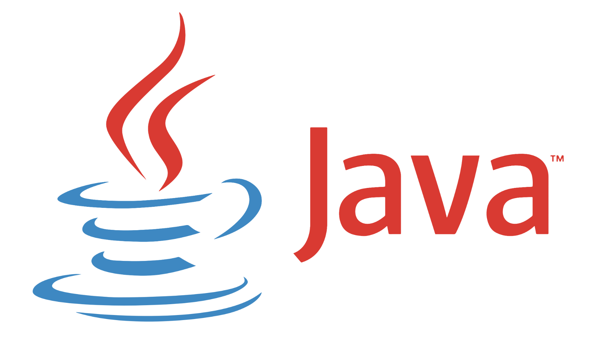

## 람다식 (Lambda Expression)

- 자바 8에서 도입됨
- 함수(메서드)를 하나의 식으로 표현하는 방법
- 익명함수 (anonymous function)
- 람다식으로 표현하면 메서드의 이름과 반환값을 생략할 수 있고, 이를 변수에 넣어 자바 코드가 매우 간결해진다.
- 메서드

```java
int max(int a, int b) {
        return a > b ? a : b ;
}
```

- 람다식

```java
(a, b) -> a > b ? a : b
```

<p />

## 람다식 작성하기

1. 메서드의 이름과 반환타입을 제거하고, “→” 를 블록\{\} 앞에 추가한다
   ```java
   ~~int max~~(int a, int b) -> {
        return a > b ? a : b ;
   }
   ```
2. 반환값이 있는 경우 식이나 값만 적고, return문 생략 가능 (끝에 “;” 를 안붙인다)
   ```java
   (int a, int b) -> a > b ? a : b
   ```
3. 매개변수의 타입이 추론 가능하면 생략 가능
   ```java
   (a, b) -> a > b ? a : b
   ```

<p />

### 람다식 작성시 주의 해야 할 사항

1. 매개변수가 하나인 경우, 괄호() 생략가능 - 타입이 없을 때만

```java
( a ) -> a * a
(int a) -> a * a
```

```java
a -> a * a      // OK
int a -> a * a  // 에러
```

1. 블록 안의 문장이 하나 뿐일 때, 괄호\{\} 생략 가능 (끝에 “;” 를 안붙인다)
   <p>
   단 하나뿐인 문장이 return문이면 괄호\{\} 생략 불가
   </p>

   ```java
   (int i) -> {
        System.out.println(i);
   }
   ```

   ```java
   (int i) -> System.out.println(i)
   ```

<p />

### 익명 화살표 함수 <code>→</code>

- 자바스크립트의 익명 화살표 함수 자체가 람다 함수의 일종
- 변수에 함수를 담을때, 자바는 강타입 언어이기에 반드시 함수에 대한 타입을 선언해야 한다.
- 하지만 자바에 8가지 타입밖에 없어, 마땅한 자료형이 없고, 인터페이스를 익명 구현 객체 타입으로서 함수를 해당 인터페이스 타입으로 받을수 있게 설계한것
  - Primitive Type(원시타입) : 실제 데이터 값을 저장한다<br />(int, long, double, float, boolean, byte, short, char)
  - Reference Type(참조 타입) : 객체를 참조하는 타입, 메모리 번지값을 통해 객체를 참조<br />Integer, Long, Double, Float, Boolean, Byte, Short, Char
  - 자바는 오토박싱, 언박싱이 잘 되어 있어, 원시 타입과 참조타입을 코드 상에 같이 사용해도 큰 문제는 발생하지 않는다.

<p />

### 람다식은 익명 함수가 아니라 익명 객체이다.

- 인터페이스를 익명 클래스로 구현한 익명 구현 객체
- 자바는 메소드를 단독으로 선언할 수 없다.

```java
(a, b) -> a > b ? a : b

// 오른쪽과 동일한 코드
```

```java
new Object() {
        int max(int a , int b) {
                return a > b ? a : b ;
        }
}
```

→ 익명 클래스, 익명 객체 : 객체의 선언과 생성을 동시에 한다.

- 람다식(익명 객체)을 다루기 위한 참조변수가 필요하다. 참조 변수의 타입은 ?
  ```java
  Object obj = new Object() {
        int max(int a , int b) {
                return a > b ? a : b ;
        }
  }
  ```

  ```java
  타입? obj = (a, b) -> a > b ? a : b ;
  ```

  <p>
  ⇒ <b>함수형 인터페이스 타입</b>
  </p>

<p />

<p />

### 함수형 인터페이스

- <b>딱 하나의 추상 메소드가 선언된 인터페이스</b>를 말한다.
- 람다식은 함수형 인터페이스 안에 정의된 하나의 추상 메소드 선언을 짧게 표현한 것

```java
// 함수형 인터페이스가 될 수 있다.
interface OkMax {
    int max(int x, int y);
}

// 함수형 인터페이스가 될수 없다.
interface NotCalculate {
    int max(int x, int y);
    int min(int x, int y);
}

// 구성요소가 많아도 결국 추상 메서드는 한개이기 때문에 함수형 인터페이스이다.
interface OkMax {
    int max(int x, int y);

    final boolean isNumber = true; // final 상수
    default void print() {};        // default 메서드
    static void print2() {};        // static 메서드
}
```

<p />

<p />

### @FunctionalInterface

인터페이스 선언시 <code>@FunctionalInterface</code> 을 사용하여, 함수형 인터페이스임을 명시적으로 선언한다.

이 어노테이션을 사용하면 컴파일러가 하나의 추상 메소드만 가지는지 검증하여 잘못된 사용을 방지할 수 있다.

```java
@FunctionalInterface
interface MyFunctionalInterface {
    void execute();
}
```

<p />

<p />

### 람다식의 타입 추론

컴파일러 스스로 람다 함수 식을 보고 타입을 유추할 수 있다.

```java
// 함수형 인터페이스
interface OkMax {
    int max(int x, int y);
}

// 람다식을 사용한 예
OkMax lambda = (a, b) -> a > b ? a : b;
```

- 람다식을 받는 메소드의 매개변수 타입을 보고, 함수형 인터페이스의 정의문을 찾아 추상 메소드의 형태를 본뒤에 추상메소드에 정의된 타입에 따라 람다 함수식의 타입을 자동으로 판별한다.
- 대부분의 함수형 인터페이스를 이용할때 제네릭(Generics)를 사용하게 되는데, 컴파일러가 타입을 추론하는데, 필요한 타입 정보 대부분을 제네릭에서 판별하여 얻는다.

아래 Collectors.toList() 의 정의문을 보면, 람다함수의 매개변수 타입은 제네릭T 타입이 들어있는 걸 볼수 있다.


toList() 메소드


<p />

<p />

### 표준 함수형 인터페이스

| 함수형 인터페이스 | 매개변수 | 메서드 | 반환값 |
| --- | --- | --- | --- |
| Runnable | X | void run() | X |
| Supplier\<T> | X | T get() | O \<T> |
| Consumer\<T> | O \<T> | void accept(T t) | X |
| Function\<T, R> | O \<T> | R apply(T t) | O (R) |
| Predicate\<T> | O \<T> | boolean test(T t) | O (boolean) |

<p />

## 람다식과 메서드 참조

- 람다식에서 파라미터의 중복을 피하기 위해 사용한다.
- \* 람다식의 메소드 참조 문법을 사용하기 위해서는 다음의 3가지 조건을 만족해야 한다. \*\*

1. 함수형 인터페이스의 매개 변수 타입 == 메소드의 매개변수 타입
2. 함수형 인터페이스의 매개 변수 개수 == 메소드의 매개변수 개수
3. 함수형 인터페이스의 반환 타입 == 메소드의 반환 타입

<p />

### 메소드 참조 종류

1. 정적 메서드 참조
   ```java
   // 기존 람다식
   Function<String, Integer> stringToInteger = (s) -> Integer.parseInt(s);

   // 정적 메소드 참조
   Function<String, Integer> stringToInteger = Integer::parseInt;
   ```
2. 인스턴스 메서드 참조
   ```java
   // 기존 람다식
   BiFunction<String, String, Boolean> stringEquals = (s1, s2) -> s1.equals(s2);

   // 인스턴스 메소드 참조
   BiFunction<String, String, Boolean> stringEquals = String::equals;
   ```
3. 매개변수의 메서드 참조
   ```java
   Function<String, Integer> size;

   // 기존 람다 식
   size = (String s1) ->  s1.length();

   // 매개변수의 메서드 참조
   size = String::length;
   ```
4. 생성자 참조
   ```java
   // 기존 람다식
   Supplier<ArrayList<String>> listSupplier = () -> new ArrayList<>();

   // 생성자 참조
   Supplier<ArrayList<String>> listSupplier = ArrayList::new;
   ```

<p />

---

### 참고

- [https://youtu.be/4ZtKiSvZNu4?si=2oPzMtEUADRxk\_Zn](https://youtu.be/4ZtKiSvZNu4?si=2oPzMtEUADRxk_Zn)
- [https://inpa.tistory.com/entry/☕-Lambda-Expression#functionalinterface](https://inpa.tistory.com/entry/%E2%98%95-Lambda-Expression#functionalinterface)
- [https://inpa.tistory.com/entry/JAVA8-☕-람다식을-더-짧게-메소드-참조Method-Reference#정적\_메소드\_참조](https://inpa.tistory.com/entry/JAVA8-%E2%98%95-%EB%9E%8C%EB%8B%A4%EC%8B%9D%EC%9D%84-%EB%8D%94-%EC%A7%A7%EA%B2%8C-%EB%A9%94%EC%86%8C%EB%93%9C-%EC%B0%B8%EC%A1%B0Method-Reference#%EC%A0%95%EC%A0%81_%EB%A9%94%EC%86%8C%EB%93%9C_%EC%B0%B8%EC%A1%B0)
