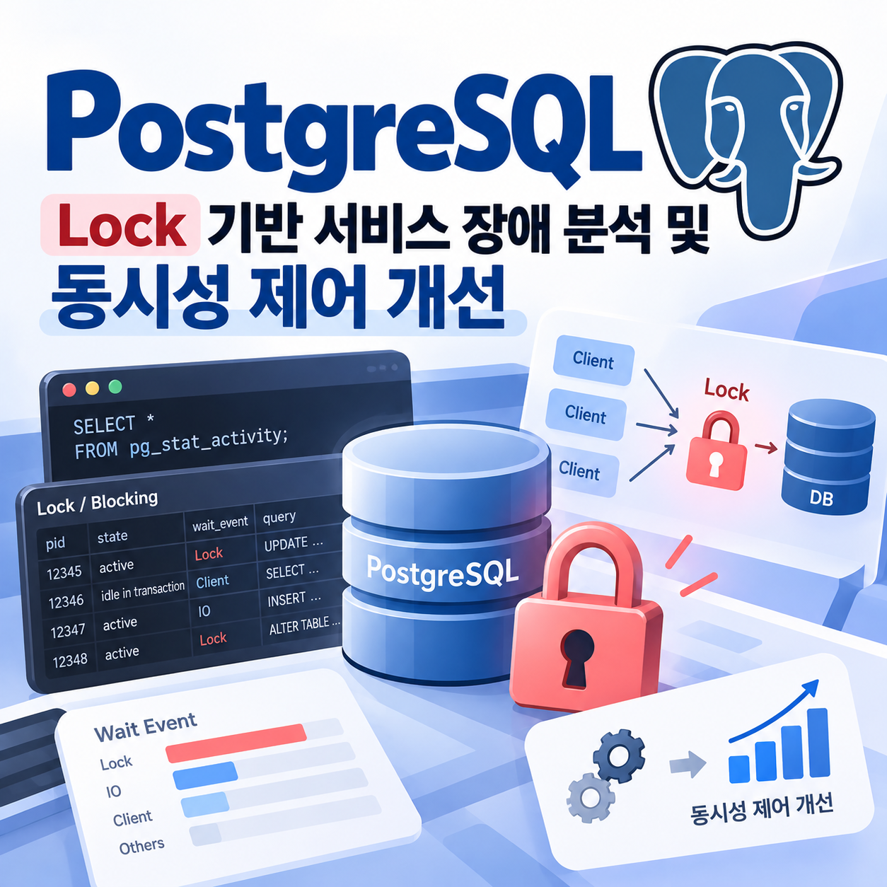

> 공개를 위해 계정명, 스키마명, 세션 PID는 예시용 식별자로 일반화했습니다.



<quote>
<p />

- <b>장애 상황</b>: 병원 데이터베이스 접속 지연 및 DBeaver 무한 로딩 ("Service is busy") 발생
- <b>원인 분석</b>: 대용량 <code>UPDATE</code> 트랜잭션 미완료 상태에서 강한 락(Exclusive)을 요구하는 <code>ALTER TABLE</code>이 수행되어 연쇄적 Blocking Chain 형성
- <b>조치 사항</b>: Root 세션(PID BLOCKER_PID) 강제 종료를 통한 즉각적인 서비스 정상화 및 운영 환경 재발 방지 가이드 수립
</quote>

## 1. 실제 장애 사례 분석

### 1-1. 장애 인지 및 현상 (Timeline)

- <b>상황 접수</b>: 외부 연구원 및 내부 사용자로부터 DB 접속 불가 및 테이블 조회 지연 문의 접수
- <b>현상 재현</b>: DBeaver 커넥션은 유지되나 쿼리 실행 시 무한 로딩 및 <code>"Service is busy"</code> 안내 문구 출력
- <b>초기 가설</b>: 단순 네트워크 이슈가 아닌, DB 엔진 내부에서 쿼리 처리가 완전히 Block된 상태로 판단

### 1-2. 장애 전파 메일 및 실시간 조치 내용

<b>\[확인 결과\]</b><br />운영 계정에서 아래 대규모 JOIN을 포함한 <code>UPDATE</code> 쿼리가 실행된 이력을 확인

```txt
UPDATE app_data.drug_exposure AS d
SET route_concept_id = m.target_concept_id
FROM app_data.source_to_concept_map AS m -- ... 이하 조건 생략
```

<p>
해당 작업(PID: BLOCKER_PID)이 <code>app_data.source_to_concept_map</code> 테이블에 대한 Row-Exclusive 락을 보유한 상태로 장시간 트랜잭션이 종료(COMMIT)되지 않고 세션을 유지하고 있었다.
</p>

<p>
이후 해당 테이블에 구조 변경(<code>ALTER TABLE</code>) DDL 작업이 들어오면서 테이블에 대한 강한 락(Access Exclusive) 대기 상태가 발생했고, 뒤이어 들어온 모든 <code>SELECT</code> 요청이 연쇄적으로 대기 상태에 빠져 DBeaver 무한 로딩을 유발하였다.
</p>

<p />

<b>\[조치 사항\]</b><br />락을 유발하고 있던 최상위 세션(PID: BLOCKER_PID)을 종료하여 락 체인을 해제함

```txt
SELECT pg_terminate_backend(<BLOCKER_PID>);
```

<p>
세션 종료 즉시 대기 중이던 DDL 및 <code>SELECT</code> 작업이 정상 처리되어 서비스가 복구되었다.
</p>

<p />

<p />

<h3>
1-3. 실시간 대응 프로세스, 수행한 부분
</h3>

```javascript
[1단계: 장애 인지] DBeaver 'Service is busy' 및 무한 로딩 현상 확인

[2단계: 세션 분석] pg_stat_activity 조회로 실행 중인 세션 및 쿼리 전수 조사

[3단계: Lock 확인] wait_event_type = 'Lock', wait_event = 'relation' 상태 탐지

[4단계: 체인 추적] PID BLOCKER_PID(UPDATE) -> PID DDL_PID(ALTER) -> SELECT 락 체인 구조 도출

[5단계: 즉각 조치] pg_terminate_backend(<BLOCKER_PID>) 실행으로 Root 세션 킬(Kill)

[6단계: 재발 방지] 운영 서버 락 발생 최소화 가이드 수립 작성, 배포
```

<p />

<p />

## 2. 락 체인 및 원인 분석

### 2-1. 현장 검증 데이터 (<code>pg_stat_activity</code>)

장애 당시 DB 메타데이터 조회를 통해 확보한 핵심 Blocker 세션 정보

```sql
SELECT pid, usename, state, wait_event_type, wait_event, query
FROM pg_stat_activity;
```

<table>
<colgroup>
<col width="71" />
<col width="89.9921875" />
<col width="72" />
<col width="101.443359375" />
<col width="94" />
<col width="354" />
</colgroup>
<tr>
<td>
<b>PID</b>
</td>
<td>
<b>User</b>
</td>
<td>
<b>State</b>
</td>
<td>
<b>Wait Event Type</b>
</td>
<td>
<b>Wait Event</b>
</td>
<td>
<b>Executing Query</b>
</td>
</tr>
<tr>
<td>
<b>BLOCKER_PID</b>
</td>
<td>
service_user
</td>
<td>
active
</td>
<td>
-
</td>
<td>
-
</td>
<td>
UPDATE app_data.drug\_exposure AS d SET ... JOIN source\_to\_concept\_map ...
</td>
</tr>
<tr>
<td>
<b>DDL_PID</b>
</td>
<td>
service_user
</td>
<td>
active
</td>
<td>
<b>Lock</b>
</td>
<td>
<b>relation</b>
</td>
<td>
ALTER TABLE app_data.source\_to\_concept\_map ADD column2 integer NULL;
</td>
</tr>
<tr>
<td>
<b>READER_PID</b>
</td>
<td>
analytics_user
</td>
<td>
active
</td>
<td>
<b>Lock</b>
</td>
<td>
<b>relation</b>
</td>
<td>
create temp table app_data.source\_death as select \* from app_data.source\_to\_concept\_map limit 1;
</td>
</tr>
</table>

### 2-2. Blocking Chain 구조 및 메커니즘

<p>
PostgreSQL의 Lock Level 특성으로 인해 발생한 단방향 락 대기 현상.
</p>

<b>데드락(Deadlock)과 달리 상호 락을 쥐고 있는 형태가 아니므로 DB가 자동 해제하지 못하고 무한 대기</b>에 빠진 케이스

```javascript
[Root Blocker] PID BLOCKER_PID (UPDATE + JOIN 실행 후 미커밋 또는 장시간 수행)
       │  (source_to_concept_map 테이블에 공유/갱신형 Lock 보유)
       ▼
[Heavy DDL] PID DDL_PID (ALTER TABLE 실행)
       │  (가장 강력한 'Access Exclusive Lock'을 요구하며 대기 큐 진입)
       ▼
[Lighter Queries] 이후 인입된 모든 SELECT 및 DBeaver 메타데이터 조회 쿼리들
          (앞선 ALTER TABLE의 강력한 Lock 대기로 인해 뒤로 줄을 서며 전부 Block)
```

<quote>
<b>💡 핵심 원인 추정</b>

1. 대용량 데이터 업데이트 작업이 유저의 미커밋(<code>COMMIT;</code> 누락)으로 인해 트랜잭션이 락을 쥔 채 유지됨.
2. 클라이언트 프로그램 툴 종료 후에도 백엔드 세션이 정상 정리되지 않고 좀비 세션으로 남아 락을 유지함.
</quote>

<p />

<p />

## 3. 관련 개념 및 분석 도구 정리

### 3-1. 트랜잭션과 동시성 제어 핵심 요약

장애를 분석하고 해결하는 과정에서 기반이 된 데이터베이스 이론적 핵심 개념입니다.

- <b>트랜잭션 ACID 특성</b>: 원자성(Atomicity), 일관성(Consistency), 고립성(Isolation), 지속성(Durability)을 통해 데이터 정합성을 보장합니다. 이번 장애는 Isolation을 보장하기 위한 락킹 메커니즘 과정에서 발생했습니다.
- <b>로킹(Locking) 기법</b>:
  - <b>공유 락 (Shared Lock)</b>: 데이터를 읽을 때 사용. Read-Read 간 동시 접근은 허용하나 수정은 불가.
  - <b>배타 락 (Exclusive Lock)</b>: 데이터를 쓸 때 사용. 다른 트랜잭션의 읽기/쓰기를 모두 차단. <code>ALTER TABLE</code> 같은 DDL은 테이블 전체에 가장 높은 수준의 배타 락을 요구합니다.
- <b>2단계 로킹 프로토콜 (2PL)</b>: 직렬성 보장을 위해 락을 확장(획득)하는 단계와 수축(해제)하는 단계로 나누어 관리하므로, 트랜잭션이 끝나기 전엔 락이 해제되지 않습니다.

### 3-2. PostgreSQL 장애 분석 3대 핵심 도구

PostgreSQL 환경에서 락 및 세션 장애 발생 시 추적을 위해 사용하는 필수 카탈로그 뷰입니다.

<table>
<tr>
<td>
<b>도구명</b>
</td>
<td>
<b>주요 역할</b>
</td>
<td>
<b>활용 방식</b>
</td>
</tr>
<tr>
<td>
<b><code>pg_stat_activity</code></b>
</td>
<td>
현재 실행 중인 모든 세션의 상태, 유저, 쿼리, 대기 이벤트 확인
</td>
<td>
장애 트래픽의 시작점 및 현재 실행 상태 분석
</td>
</tr>
<tr>
<td>
<b><code>pg_locks</code></b>
</td>
<td>
테이블, 트랜잭션 단위로 걸려 있는 구체적인 락 종류와 부여 여부(granted) 확인
</td>
<td>
어떤 세션이 락을 소유하고 유발하는지 정밀 추적
</td>
</tr>
<tr>
<td>
<b><code>pg_blocking_pids()</code></b>
</td>
<td>
특정 세션(PID)의 진행을 가로막고 있는 직속 Blocker PID 배열 반환
</td>
<td>
<code>SELECT pg_blocking_pids(<DDL_PID>);</code> 형태로 락 체인 속성 즉시 파악
</td>
</tr>
</table>

- <b>REDO / UNDO</b>: 성공한 트랜잭션은 REDO(재실행)로 디스크에 반영하고, 실패한 트랜잭션은 UNDO(취소)로 되돌림.
- <b>지연 갱신 vs 즉각 갱신</b>: 지연 갱신은 커밋 전까지 디스크 반영을 미뤄 UNDO가 불필요(REDO만 수행), 즉각 갱신은 즉시 반영하여 둘 다 필요함.
- <b>체크포인트 회복</b>: 주기적인 Checkpoint를 통해 복구 시점을 단축함.
- <b>그림자 페이징(Shadow Paging)</b>: 복사본 페이지 테이블을 이용해 작업하므로 별도의 UNDO 작업 없이 원본 스위칭으로 빠른 복구 가능.

<p />

## 4. 개선 방안 및 향후 대응 (Action Item)

- <b>\[운영 환경 Rule 수립\] 대용량 UPDATE 및 데이터 검증 작업 금지</b>
  - 대규모 JOIN, 대용량 데이터 적재 및 정합성 테스트 등 장시간 락을 유발할 수 있는 연산은 운영 환경(NCP 서버)에서 직접 수행을 지양함.
  - 반드시 로컬 혹은 별도의 개발/검증 환경에서 사전 검증 후 분할(Chunking) 처리하여 운영에 반영하도록 프로세스 가이드 배포.
- <b>\[트랜잭션 관리 강화\] 명시적 COMMIT 확인 및 세션 타임아웃 설정</b>
  - 수동 쿼리 실행 시 트랜잭션이 열린 채 방치되지 않도록 반드시 쿼리 종료 후 <code>COMMIT;</code> 또는 <code>ROLLBACK;</code> 상태를 확인하도록 휴먼 에러 방지
- <b>\[DDL 수행 가이드\] 운영 시간 내 테이블 구조 변경 지양</b>
  - <code>ALTER TABLE</code>과 같이 테이블 전체 락을 유발하는 DDL 작업은 서비스 영향도가 가장 적은 새벽 시간대 또는 점검 시간에 수행하도록 통제.
  - <code>pg_stat_activity</code> 내 <code>wait_event_type = 'Lock'</code> 상태가 5분 이상 지속되는 장기 세션 발생 시 알림을 보낼 수 있는 임계치 모니터링 체계 도입 검토.

<p />
