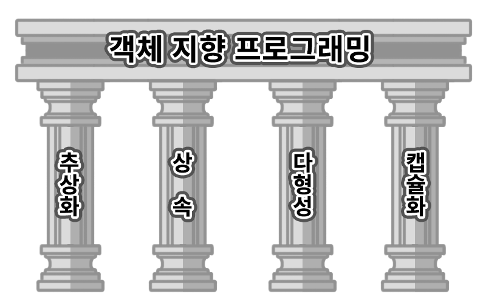

<p />

<b>자바는 객체 지향 프로그래밍 언어이다.</b>

모든 요소들이 객체로 표현되고, 객체 지향 개념의 특징인 <b>추상화, 캡슐화, 상속, 다형성</b> 이 적용된 언어이다.

이러한 객체 지향적 프로그램을 설계를 하면, 각각의 클래스, 메소드들이 각자 독립적인 역할을 가지기 때문에 코드 변경을 최소화하고 유지 보수를 하는데 유리하다. 코드의 재사용으로 반복적인 코드를 최소화하고 간결하게 표현할 수 있는것이다.

<p />

## 객체(object)란?

객체는 객체지향 프로그래밍의 가장 기본적인 단위, “모든 실재하는 대상”

객체는 책상, 의자, 시계 뿐만아니라 눈에 보이지 않는 논리, 철학, 개념들도 포함될 수 있다.

우리가 보고 느끼고 인지할 수 있는 그 모든 것을 의미한다.

객체 지향 프로그래밍에서는 객체를 추상화 시켜 속성(state)과 기능(behavior)으로 분류한 후에 이것을 다시 각각 변수(variable)와 함수(function)로 정의한다.

<p />

## 객체 지향 프로그래밍의 특징 4가지

1. <code>추상화(Abstraction)</code> : 객체에서 공통된 속성과 행위를 추출하여 정의하는 것
   - 자바에서는 추상 클래스(abstract class)와 인터페이스(interface)로 구현할 수 있다.

   ```java
   public interface Vehicle {
        public abstract void start()
        void moveForward();
        void moveBackward();
   }

   # 이동수단이라는 상위 클래스에서는 전진과 후진이라는 공통적인 기능을 추출해 선언하였다.
   ```

   - 인터페이스는 추상 메서드나 상수를 통해 객체의 역할만을 정의해두고, 실제적인 구현은 해당 인터페이스를 구현하는 각각의 객체에서 하도록 설계한다.
   - 역할과 구현의 분리 ⇒ <b>객체 지향 프로그래밍에서 유연한 프로그램을 설계하는데 핵심적인 부분</b>

   <quote>
   추상클래스 : 확장자의 역할 / 상속을 받아서 기능을 이용하고 확장시킨다.

   인터페이스 : 명세서의 역할 / 함수 껍데기 - 함수의 구현을 강제해주어, 구현 객체의 같은 동작을 보장한다.
   </quote>
2. <code>상속 (Inheritance)</code> : 기존의 클래스를 재활용하여 새로운 클래스를 작성하는 자바의 문법 요소
   - 상속은 상위 클래스로부터 확장된 여러개의 하위 클래스들이 모두 상위 클래스의 속성과 기능들을 간편하게 사용할 수 있도록 한다.
   - 반복해서 정의할 필요없이 딱 한번만 정의해두고 재사용할 수 있어, 코드를 최소화하고 공유하는 속성과 기능에 간편하게 접근하여 사용할 수 있도록 한다.
   - <b>메서드 오버라이딩</b> : 상위 클래스의 기능과 속성을 그대로 사용할 수도 있지만, 각각의 클래스의 맥락에 맞게 내용을 재정의 할 수도 있다.
   - 위의 인터페이스를 사용하는 구현에 비해 추상화의 정도가 낮다. 모든 구체적인 내용을 정의해두고, 하위 클래스에서는 단순히 가져다가 재사용 할 수 있다.
3. <code>다형성 (Polymorphism)</code> : 어떤 객체의 속성이나 기능이 상황에 따라 여러가지 형태를 가질 수 있는 성질
   - 한 타입의 참조 변수를 통해 여러 타입의 객체를 참조할 수 있도록 만든것
   - 상위 클래스 타입의 참조변수로 하위 클래스의 객체를 참조할 수 있도록 하는 것
   - 메서드 오버라이딩, 메서드 오버로딩
   - 다형성을 활용하면 여러 종류의 객체를 배열로 다루는 일이 가능해진다.
     ```java
     public class Main {
         public static void main(String[] args) {
             // 상위 클래스 타입의 객체 배열 선언
             Vehicle vehicles[] = new Vehicle[2];
             vehicles[0] = new Car();
             vehicles[1] = new MotorBike();

             for (Vehicle vehicle : vehicles) {
                 System.out.println(vehicle.getClass()); // 각각의 클래스를 확인하는 메서드
             }
         }
     }

     // 클래스 정의
     class Car {}
     class MotorBike {}
     ```
   - 하나의 타입만으로 여러 가지 타입의 객체를 참조할 수 있다.
4. <code>캡슐화 (Encapsulation)</code> : 서로 연관되어 있는 속성과 기능들을 하나의 캡슐로 만들어 데이터를 외부로부터 보호하는 것을 말한다.
   - 캡슐화를 하는 이유
     - 데이터 보호 : 외부로부터 클래스에 정의된 속성과 기능들을 보호
     - 데이터 은닉 : 내부의 동작을 감추고 외부에는 필요한 부분만 노출
   - 데이터 보호와 데이터 은닉으로 각 객체 고유의 독립성과 책임 영역을 안전하게 지키고자하는 목적

<p />

## 정보 은닉과 캡슐화의 차이점

- 정보은닉 : 데이터 구현이 외부 모듈에 알려지지 않아야 한다고 설명하며 단어 생성
- 캡슐화 : 원치 않는 수정을 방지하기 위해 클래스의 기본 데이터에 대한 엑세스를 줄이는 방법 설명을 위해 단어 고안

초반에는 단어가 동의어로 사용되어있지만, 2001년 paul roger가 정보를 숨기지 않고 캡슐화 할 수 있다고 주장. <b>캡슐화는 클래스를 사용하여 외부 코드를 손상시키지 않고 클래스에 기능을 도입</b>

```java
class BookEncapsulation {
    public String author;
    public int isbn;
    public BookEncapsulation(String author, int isbn) {
        this.author = author;
        this.isbn = isbn;
    }
    public String getBookDetails() {
        return "author name: " + author + " ISBN: " + isbn;
    }
}
```

→  <i>id</i> 를 도입하여 <i>BookEncapsulation</i> 클래스를 수정

```java
// ...
public int id = 1;
public BookEncapsulation(String author, int isbn) {
    this.author = author;
    this.isbn = isbn;
}
public String getBookDetails() {
    return "author id: " + id + " author name: " + author + " ISBN: " + isbn;
}
// ...
```

→ 이러한 내부 변경 사항은 클라이언트 코드를 손상시키지 않는다. 이는 캡슐화를 강력하고 모듈화시켜준다

public으로 모든 엑세스 수정자를 사용할수 있는 문제점 발생

하지만, 정보은닉 개념을 적용하면 캡슐화를 더욱 엄격하게 만들수 있다.

- <b>정보 은닉은 클래스 데이터의 직접적인 수정을 방지하는 것을 목표로 하는</b> 프로그래밍 원칙

```java
class BookInformationHiding {
    private String author;  // private 액세스 수정자로 변경
    private int isbn;
    private int id = 1;

    public BookInformationHiding(String author, int isbn) {
        setAuthor(author);
        setIsbn(isbn);
    }
    public String getAuthor() {
        return author;
    }
    public void setAuthor(String author) {
        this.author = author;
    }
    public int getIsbn() {
        return isbn;
    }
    public void setIsbn(int isbn) {
        this.isbn = isbn;
    }
    public String getBookDetails() {
        return "author id: " + id + " author name: " + author + " ISBN: " + isbn;
    }
}
```

→ private 액세스 수정자로 변경 외부 클래스의 필드 액세스 및 변경을 제한한다.

→ 필드에 엑세스하고 수정하는 방법을 설정하기 위해 getter와 setter를 만든다.

<p />

| 정보 은닉 | 캡슐화 |
| --- | --- |
| 구현 세부 사항과 의도하지 않은 데이터 수정을 숨기는 설계 원칙 | 데이터를 작동하는 기능과 함께 묶는 객체 지향 원리 |
| private 액세스 수정자를 엄격하게 사용합니다. | 액세스 한정자에 엄격하지 않으며 public , private 또는 protected 액세스 한정자를 사용할 수 있다. |
| defensive 프로그래밍을 달성하는 데 도움이 됩니다. | 정보 은닉을 달성하기 위한 방법론 |

결론 : 클래스를 캡슐화할때 정보 은닉의 원칙을 적용해야 한다. 하지만 두 단어는 동일어가 아니다!

<p />

---

### 출처

1. [https://www.codestates.com/blog/content/객체-지향-프로그래밍-특징](https://www.codestates.com/blog/content/%EA%B0%9D%EC%B2%B4-%EC%A7%80%ED%96%A5-%ED%94%84%EB%A1%9C%EA%B7%B8%EB%9E%98%EB%B0%8D-%ED%8A%B9%EC%A7%95)
2. [https://www.baeldung.com/java-information-hiding-vs-encapsulation](https://www.baeldung.com/java-information-hiding-vs-encapsulation)

---

더 알아볼것 - 의존관계 주입 (객체 간 높은 결합도를 해결하는 것)
